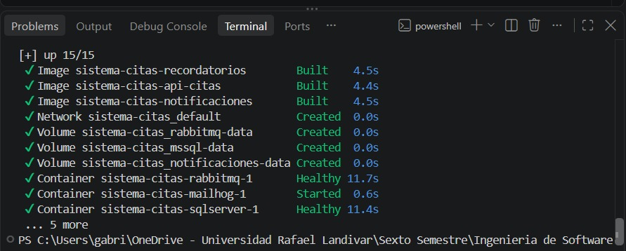

# Evidencia K-02 — Entorno completo levantado con Docker Compose

**Responsable:** Gabriel Toyom · **Fecha:** 14/10/2026 · **Requisito:** infraestructura base (habilita RF-02 y RNF-01)

## Objetivo

Demostrar el criterio de aceptación de K-02: con un solo comando se construye y levanta el entorno completo de la demo (broker, SQL Server, MailHog, inicialización de bases de datos, API, dos consumidores y portal) sin errores.

## Pasos ejecutados

Desde la raíz del repositorio, con Docker Desktop iniciado y `.env` creado a partir de `.env.example`:

```bash
git switch main
git pull
docker compose down -v          # arranque desde cero, sin datos previos
docker compose up -d --build    # construye las imágenes y levanta los servicios
```

## Resultado

| Verificación | Esperado | Obtenido |
|---|---|---|
| Recursos de Compose | Todos los recursos creados sin error | `[+] up 15/15`: 15 de 15 recursos completados |
| Imágenes de los servicios Node | Se construyen las 3 imágenes desde el `Dockerfile` común | `sistema-citas-recordatorios`, `sistema-citas-api-citas` y `sistema-citas-notificaciones`: *Built* (≈ 4.5 s cada una) |
| Red y volúmenes | Red del proyecto y 3 volúmenes persistentes | `sistema-citas_default`, `rabbitmq-data`, `mssql-data` y `notificaciones-data`: *Created* |
| Broker y base de datos | `rabbitmq` y `sqlserver` pasan su healthcheck | `rabbitmq-1` *Healthy* (11.7 s) y `sqlserver-1` *Healthy* (11.4 s) |
| Resto de contenedores | `mailhog`, `db-init`, `api-citas`, `notificaciones`, `recordatorios` y `portal` completados | `mailhog-1` *Started*; los otros 5 completados (la terminal los resume como `... 5 more`) |

Los 15 recursos son: 3 imágenes, 1 red, 3 volúmenes y 8 contenedores. Que el total llegue a 15/15 confirma también que `db-init` terminó con éxito, porque `api-citas` y `recordatorios` solo inician con la condición `service_completed_successfully` sobre `db-init`.

Captura de la salida de `docker compose up -d --build`:



## Conclusión

- [x] Cumple el criterio de aceptación
- Observaciones: la terminal resume 5 contenedores como `... 5 more`. Para mostrar el estado individual de los 8 contenedores (incluido `db-init` en `Exited (0)`).
