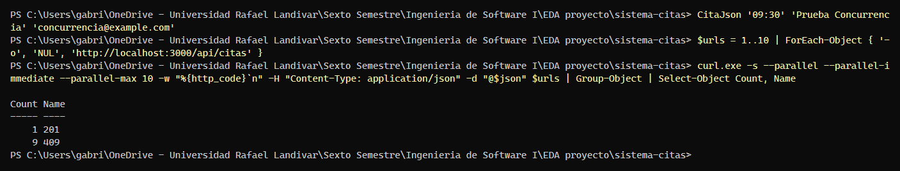
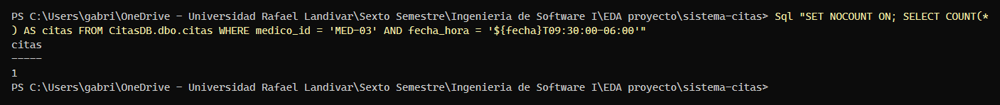

# Evidencia K-12 — Reservas simultáneas: una aceptada y el resto rechazadas

**Responsable:** Sophia Corea · **Fecha:** 22/10/2026 · **Requisito:** RF-01

## Objetivo

Demostrar el criterio de aceptación de K-12: **10 solicitudes simultáneas al mismo médico y horario producen exactamente 1 respuesta `201` y 9 respuestas `409`**, y en CitasDB queda una sola cita. La restricción `UQ_citas_medico_fecha` impide la doble reserva aunque las solicitudes lleguen al mismo tiempo.

## Preparación

En PowerShell, desde la raíz del repositorio, con la demo levantada desde cero:

```powershell
docker compose down -v
docker compose up -d --build
docker compose ps -a        # esperar: rabbitmq, sqlserver y api-citas "healthy"; db-init "Exited (0)"
```

Funciones de apoyo (pegar una sola vez en la misma terminal; ajustar la clave si se cambió en `.env`):

```powershell
$fecha = (Get-Date).AddDays(1).ToString('yyyy-MM-dd')
$sa    = 'Cambiar_Sa_Clave_1'                       # MSSQL_SA_PASSWORD de tu .env
$json  = Join-Path $env:TEMP 'cita.json'
function Sql($consulta) { docker compose exec -T sqlserver /opt/mssql-tools18/bin/sqlcmd -S localhost -U sa -P $sa -C -W -Q $consulta }
function CitaJson($hora, $nombre, $email) {
  @{ medicoId = 'MED-03'; fechaHora = "${fecha}T${hora}:00-06:00"; paciente = @{ nombre = $nombre; email = $email } } |
    ConvertTo-Json | Set-Content -Encoding ascii $json
}
```

## Pasos ejecutados

1. Preparar la solicitud (mañana a las 09:30 con la Dra. Lucía Ramírez, MED-03):

```powershell
CitaJson '09:30' 'Prueba Concurrencia' 'concurrencia@example.com'
```

2. Enviar 10 solicitudes **en paralelo** y agrupar los códigos de respuesta (captura K-12-1):

```powershell
$urls = 1..10 | ForEach-Object { '-o', 'NUL', 'http://localhost:3000/api/citas' }
curl.exe -s --parallel --parallel-immediate --parallel-max 10 -w "%{http_code}`n" -H "Content-Type: application/json" -d "@$json" $urls | Group-Object | Select-Object Count, Name
```

3. Verificar en CitasDB cuántas citas quedaron para ese horario (captura K-12-2):

```powershell
Sql "SET NOCOUNT ON; SELECT COUNT(*) AS citas FROM CitasDB.dbo.citas WHERE medico_id = 'MED-03' AND fecha_hora = '${fecha}T09:30:00-06:00'"
```

> Si las 10 respuestas son `409`, ese horario ya estaba ocupado: cambiar `'09:30'` en los pasos 1 y 3 por otro horario libre (07:00 a 20:45, cada 15 minutos).

## Resultado

| Verificación | Esperado | Obtenido |
|---|---|---|
| Respuestas de las 10 solicitudes simultáneas | 1 × `201` y 9 × `409` | 1 × `201` y 9 × `409` |
| Citas guardadas para MED-03 en ese horario | 1 | 1 |

Capturas:





## Conclusión

- [x] Cumple el criterio de aceptación
- Observaciones o fallos encontrados: Ninguno. La restricción `UQ_citas_medico_fecha` rechazó con `409` las 9 solicitudes que llegaron al mismo tiempo que la aceptada.
- Ejecutada el 22/10/2026 sobre `main` (`b7a1731`) con el entorno levantado desde cero (`docker compose down -v`), por Gabriel Toyom con asistencia de Claude. Las capturas reproducen la salida real de la terminal de PowerShell.
