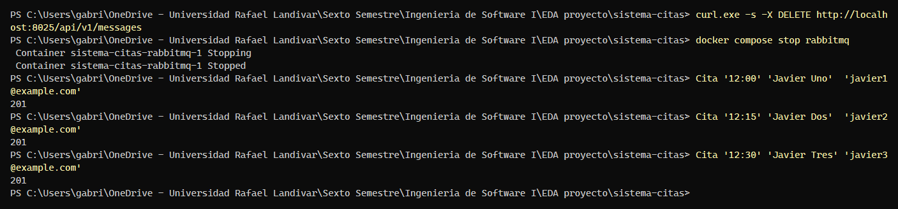
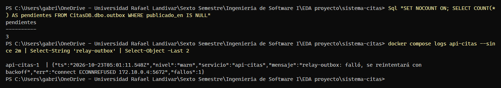
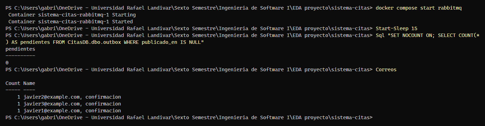

# Evidencia K-17 — Citas aceptadas con el broker detenido

**Responsable:** Javier Monje · **Fecha:** 22/10/2026 · **Requisito:** RF-02 / RNF-01

## Objetivo

Demostrar el flujo alterno 6a del caso de uso CU-01: **con RabbitMQ detenido, la API sigue registrando citas (`201`)**. Los eventos quedan pendientes en la tabla `outbox` y, cuando el broker vuelve, el relay los publica sin perder ninguno.

## Preparación

En PowerShell, desde la raíz del repositorio, con la demo levantada desde cero:

```powershell
docker compose down -v
docker compose up -d --build
docker compose ps -a        # esperar: rabbitmq, sqlserver y api-citas "healthy"; db-init "Exited (0)"
```

Funciones de apoyo (pegar una sola vez en la misma terminal; ajustar la clave si se cambió en `.env`):

```powershell
$fecha = (Get-Date).AddDays(1).ToString('yyyy-MM-dd')
$sa    = 'Cambiar_Sa_Clave_1'                       # MSSQL_SA_PASSWORD de tu .env
$json  = Join-Path $env:TEMP 'cita.json'
function Sql($consulta) { docker compose exec -T sqlserver /opt/mssql-tools18/bin/sqlcmd -S localhost -U sa -P $sa -C -W -Q $consulta }
function Cita($hora, $nombre, $email) {
  @{ medicoId = 'MED-03'; fechaHora = "${fecha}T${hora}:00-06:00"; paciente = @{ nombre = $nombre; email = $email } } |
    ConvertTo-Json | Set-Content -Encoding ascii $json
  curl.exe -s -o NUL -w "%{http_code}`n" -H "Content-Type: application/json" -d "@$json" http://localhost:3000/api/citas
}
function Correos {
  (curl.exe -s "http://localhost:8025/api/v2/messages?limit=200" | ConvertFrom-Json).items |
    ForEach-Object { [pscustomobject]@{ Para = $_.Content.Headers.To[0]; Tipo = $(if ($_.Content.Headers.Subject[0] -match 'Recordatorio') { 'recordatorio' } else { 'confirmacion' }) } } |
    Group-Object Para, Tipo | Select-Object Count, Name
}
```

## Pasos ejecutados

1. Vaciar la bandeja de MailHog y detener el broker:

```powershell
curl.exe -s -X DELETE http://localhost:8025/api/v1/messages
docker compose stop rabbitmq
```

2. Agendar 3 citas con el broker caído (captura K-17-1):

```powershell
Cita '12:00' 'Javier Uno'  'javier1@example.com'
Cita '12:15' 'Javier Dos'  'javier2@example.com'
Cita '12:30' 'Javier Tres' 'javier3@example.com'
```

3. Comprobar que los 3 eventos quedaron pendientes en el outbox y que el relay está reintentando (captura K-17-2):

```powershell
Sql "SET NOCOUNT ON; SELECT COUNT(*) AS pendientes FROM CitasDB.dbo.outbox WHERE publicado_en IS NULL"
docker compose logs api-citas --since 2m | Select-String 'relay-outbox' | Select-Object -Last 2
```

4. Volver a iniciar el broker, esperar unos 15 segundos y comprobar que el outbox se vació y que llegaron los 3 correos (captura K-17-3):

```powershell
docker compose start rabbitmq
Start-Sleep 15
Sql "SET NOCOUNT ON; SELECT COUNT(*) AS pendientes FROM CitasDB.dbo.outbox WHERE publicado_en IS NULL"
Correos
```

> Mientras RabbitMQ está detenido, Notificaciones y Recordatorios se reinician solos hasta que el broker vuelve. Es esperado.

## Resultado

| Verificación | Esperado | Obtenido |
|---|---|---|
| Respuestas con el broker detenido | 3 × `201` | 3 × `201` |
| Eventos pendientes en `outbox` con el broker detenido | 3 | 3 |
| Log del relay con el broker detenido | `relay-outbox: falló, se reintentará con backoff` | `relay-outbox: falló, se reintentará con backoff` (`connect ECONNREFUSED …:5672`, `fallos: 1`) |
| Eventos pendientes tras volver el broker | 0 | 0 |
| Correos de confirmación en MailHog | 1 por cada paciente (3 en total) | 3 confirmaciones: 1 para `javier1`, 1 para `javier2` y 1 para `javier3` |

Capturas:







## Conclusión

- [x] Cumple el criterio de aceptación
- Observaciones o fallos encontrados: Ninguno. En el momento de la captura K-17-2 el relay llevaba un intento fallido; al volver RabbitMQ publicó los 3 eventos en menos de 15 s.
- Ejecutada el 22/10/2026 sobre `main` (`b7a1731`) con el entorno levantado desde cero (`docker compose down -v`), por Gabriel Toyom con asistencia de Claude. Las capturas reproducen la salida real de la terminal de PowerShell.
