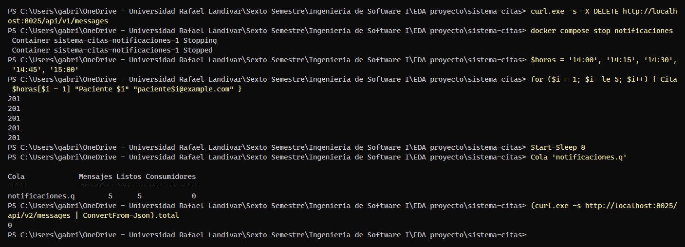
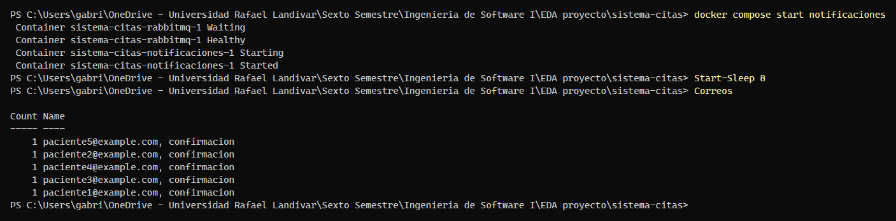
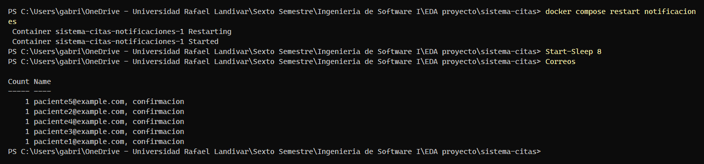

# Evidencia K-21 — Idempotencia: 5 citas con el servicio detenido, 0 duplicados

**Responsable:** Ruddy Cuyán · **Fecha:** 22/10/2026 · **Requisito:** RNF-01

## Objetivo

Demostrar el criterio de aceptación de K-21 (RNF-01): **si el Servicio de Notificaciones está detenido mientras se agendan 5 citas, los eventos esperan en la cola y, al reiniciarlo, se envían 5 correos sin duplicados**. Un reinicio adicional tampoco reenvía correos, porque cada `eventId` procesado queda registrado.

## Preparación

En PowerShell, desde la raíz del repositorio, con la demo levantada desde cero:

```powershell
docker compose down -v
docker compose up -d --build
docker compose ps -a        # esperar: rabbitmq, sqlserver y api-citas "healthy"; db-init "Exited (0)"
```

Funciones de apoyo (pegar una sola vez en la misma terminal; ajustar las claves si se cambiaron en `.env`):

```powershell
$fecha = (Get-Date).AddDays(1).ToString('yyyy-MM-dd')
$rmq   = 'citas:Cambiar_Rabbit_1'                   # RABBITMQ_USER:RABBITMQ_PASSWORD de tu .env
$json  = Join-Path $env:TEMP 'cita.json'
function Cita($hora, $nombre, $email) {
  @{ medicoId = 'MED-03'; fechaHora = "${fecha}T${hora}:00-06:00"; paciente = @{ nombre = $nombre; email = $email } } |
    ConvertTo-Json | Set-Content -Encoding ascii $json
  curl.exe -s -o NUL -w "%{http_code}`n" -H "Content-Type: application/json" -d "@$json" http://localhost:3000/api/citas
}
function Correos {
  (curl.exe -s "http://localhost:8025/api/v2/messages?limit=200" | ConvertFrom-Json).items |
    ForEach-Object { [pscustomobject]@{ Para = $_.Content.Headers.To[0]; Tipo = $(if ($_.Content.Headers.Subject[0] -match 'Recordatorio') { 'recordatorio' } else { 'confirmacion' }) } } |
    Group-Object Para, Tipo | Select-Object Count, Name
}
function Cola($nombre) {
  $q = curl.exe -s -u $rmq "http://localhost:15672/api/queues/%2F/$nombre" | ConvertFrom-Json
  [pscustomobject]@{ Cola = $q.name; Mensajes = $q.messages; Listos = $q.messages_ready; Consumidores = $q.consumers }
}
```

## Pasos ejecutados

1. Vaciar la bandeja de MailHog y detener Notificaciones:

```powershell
curl.exe -s -X DELETE http://localhost:8025/api/v1/messages
docker compose stop notificaciones
```

2. Agendar 5 citas (pacientes distintos) y, tras unos segundos, revisar la cola y la bandeja (captura K-21-1):

```powershell
$horas = '14:00', '14:15', '14:30', '14:45', '15:00'
for ($i = 1; $i -le 5; $i++) { Cita $horas[$i - 1] "Paciente $i" "paciente$i@example.com" }
Start-Sleep 8
Cola 'notificaciones.q'
(curl.exe -s http://localhost:8025/api/v2/messages | ConvertFrom-Json).total
```

3. Iniciar Notificaciones y revisar los correos: debe haber **1 confirmación por paciente** (captura K-21-2):

```powershell
docker compose start notificaciones
Start-Sleep 8
Correos
```

4. Reiniciar otra vez el servicio y comprobar que **no se reenvía nada** (captura K-21-3):

```powershell
docker compose restart notificaciones
Start-Sleep 8
Correos
```

> Hacer los pasos 2 a 4 en menos de 1 minuto. Pasados unos 60 s llegan también los recordatorios (1 por paciente, tipo `recordatorio`); no son duplicados.

## Resultado

| Verificación | Esperado | Obtenido |
|---|---|---|
| Respuestas al agendar | 5 × `201` | 5 × `201` |
| `notificaciones.q` con el servicio detenido | 5 mensajes listos, 0 consumidores | 5 mensajes, 5 listos, 0 consumidores |
| Correos con el servicio detenido | 0 | 0 |
| Correos tras iniciar el servicio | 1 confirmación por paciente (5 en total) | 5 confirmaciones: 1 por paciente (`paciente1` a `paciente5`) |
| Correos tras un segundo reinicio | Igual que antes: 1 por paciente, sin duplicados | Sin cambios: 1 confirmación por paciente, sin duplicados |

Capturas:







## Conclusión

- [x] Cumple el criterio de aceptación
- Observaciones o fallos encontrados: Ninguno.
- Ejecutada el 22/10/2026 sobre `main` (`b7a1731`) con el entorno levantado desde cero (`docker compose down -v`), por Gabriel Toyom con asistencia de Claude. Las capturas reproducen la salida real de la terminal de PowerShell.
