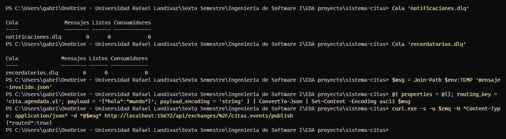
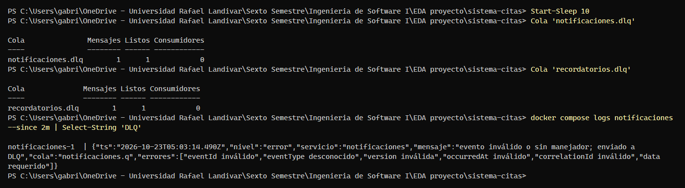
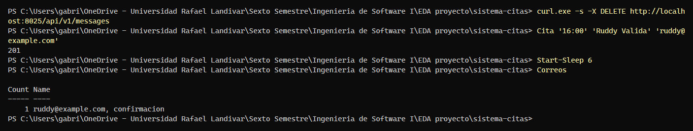

# Evidencia K-22 — Mensaje inválido enviado a la cola de mensajes muertos (DLQ)

**Responsable:** Ruddy Cuyán · **Fecha:** 22/10/2026 · **Requisito:** RNF-01

## Objetivo

Demostrar el criterio de aceptación de K-22: **un mensaje inválido publicado en el broker no bloquea a los consumidores**. Se envía a `notificaciones.dlq` (y a `recordatorios.dlq`) y el Servicio de Notificaciones sigue procesando citas válidas.

## Preparación

En PowerShell, desde la raíz del repositorio, con la demo levantada desde cero:

```powershell
docker compose down -v
docker compose up -d --build
docker compose ps -a        # esperar: rabbitmq, sqlserver y api-citas "healthy"; db-init "Exited (0)"
```

Funciones de apoyo (pegar una sola vez en la misma terminal; ajustar las claves si se cambiaron en `.env`):

```powershell
$fecha = (Get-Date).AddDays(1).ToString('yyyy-MM-dd')
$rmq   = 'citas:Cambiar_Rabbit_1'                   # RABBITMQ_USER:RABBITMQ_PASSWORD de tu .env
$json  = Join-Path $env:TEMP 'cita.json'
function Cita($hora, $nombre, $email) {
  @{ medicoId = 'MED-03'; fechaHora = "${fecha}T${hora}:00-06:00"; paciente = @{ nombre = $nombre; email = $email } } |
    ConvertTo-Json | Set-Content -Encoding ascii $json
  curl.exe -s -o NUL -w "%{http_code}`n" -H "Content-Type: application/json" -d "@$json" http://localhost:3000/api/citas
}
function Correos {
  (curl.exe -s "http://localhost:8025/api/v2/messages?limit=200" | ConvertFrom-Json).items |
    ForEach-Object { [pscustomobject]@{ Para = $_.Content.Headers.To[0]; Tipo = $(if ($_.Content.Headers.Subject[0] -match 'Recordatorio') { 'recordatorio' } else { 'confirmacion' }) } } |
    Group-Object Para, Tipo | Select-Object Count, Name
}
function Cola($nombre) {
  $q = curl.exe -s -u $rmq "http://localhost:15672/api/queues/%2F/$nombre" | ConvertFrom-Json
  [pscustomobject]@{ Cola = $q.name; Mensajes = $q.messages; Listos = $q.messages_ready; Consumidores = $q.consumers }
}
```

## Pasos ejecutados

1. Estado inicial de las colas de mensajes muertos:

```powershell
Cola 'notificaciones.dlq'
Cola 'recordatorios.dlq'
```

2. Publicar un mensaje inválido en el exchange `citas.events` con la clave de ruteo `cita.agendada.v1`.

   **Opción A, consola web (recomendada para la captura K-22-1):** abrir http://localhost:15672 → *Exchanges* → `citas.events` → *Publish message*, con *Routing key* `cita.agendada.v1` y *Payload* `{"hola": "mundo"}` → **Publish message**.

   **Opción B, PowerShell (la usada en esta evidencia):**

```powershell
$msg = Join-Path $env:TEMP 'mensaje-invalido.json'
@{ properties = @{}; routing_key = 'cita.agendada.v1'; payload = '{"hola":"mundo"}'; payload_encoding = 'string' } |
  ConvertTo-Json | Set-Content -Encoding ascii $msg
curl.exe -s -u $rmq -H "Content-Type: application/json" -d "@$msg" http://localhost:15672/api/exchanges/%2F/citas.events/publish
```

3. Esperar unos 10 segundos (la consola de RabbitMQ actualiza sus contadores cada 5 s) y revisar las DLQ y el log del servicio (captura K-22-2). En la consola web también se puede abrir `notificaciones.dlq` → *Get messages* para ver el mensaje.

```powershell
Start-Sleep 10
Cola 'notificaciones.dlq'
Cola 'recordatorios.dlq'
docker compose logs notificaciones --since 2m | Select-String 'DLQ'
```

4. Comprobar que el servicio **sigue consumiendo**: agendar una cita válida y verificar su correo (captura K-22-3):

```powershell
curl.exe -s -X DELETE http://localhost:8025/api/v1/messages
Cita '16:00' 'Ruddy Valida' 'ruddy@example.com'
Start-Sleep 6
Correos
```

## Resultado

| Verificación | Esperado | Obtenido |
|---|---|---|
| Mensajes en `notificaciones.dlq` antes | 0 | 0 (`recordatorios.dlq` también en 0) |
| Mensajes en `notificaciones.dlq` después | 1 | 1 |
| Mensajes en `recordatorios.dlq` después | 1 (el evento también llega al consumidor 2) | 1 |
| Log de Notificaciones | `evento inválido o sin manejador; enviado a DLQ` | `evento inválido o sin manejador; enviado a DLQ`, con 6 errores de validación (`eventId`, `eventType`, `version`, `occurredAt`, `correlationId` y `data`) |
| Cita válida posterior | `201` y 1 correo de confirmación para `ruddy@example.com` | `201` y 1 correo de confirmación para `ruddy@example.com` |

Capturas:







## Conclusión

- [x] Cumple el criterio de aceptación
- Observaciones o fallos encontrados: Ninguno. Se usó la opción B (PowerShell); la API de RabbitMQ respondió `{"routed":true}`.
- Ejecutada el 22/10/2026 sobre `main` (`b7a1731`) con el entorno levantado desde cero (`docker compose down -v`), por Gabriel Toyom con asistencia de Claude. Las capturas reproducen la salida real de la terminal de PowerShell.
