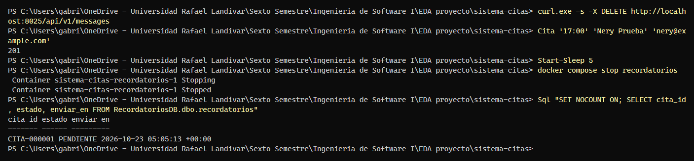
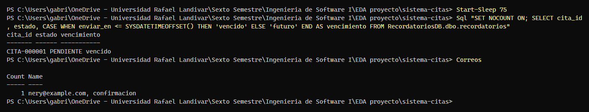
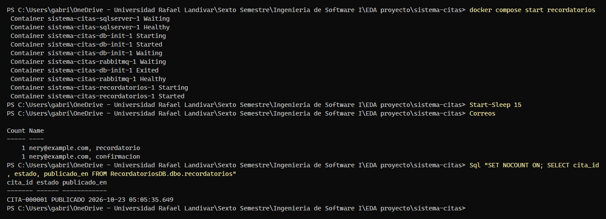
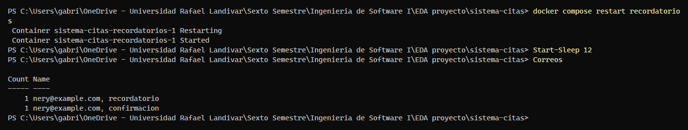

# Evidencia K-27 — Recordatorio pendiente publicado una sola vez tras un reinicio

**Responsable:** Nery Herrera · **Fecha:** 22/10/2026 · **Requisito:** RF-04 / RNF-01

## Objetivo

Demostrar el criterio de aceptación de K-27: **si el Servicio de Recordatorios está detenido cuando vence un recordatorio, al reiniciarse lo publica una sola vez**. El recordatorio queda guardado en RecordatoriosDB (`PENDIENTE` → `PUBLICADO`) y un reinicio adicional no lo repite.

## Preparación

En PowerShell, desde la raíz del repositorio, con la demo levantada desde cero (`REMINDER_DEMO_DELAY_SECONDS=60` en `.env`):

```powershell
docker compose down -v
docker compose up -d --build
docker compose ps -a        # esperar: rabbitmq, sqlserver y api-citas "healthy"; db-init "Exited (0)"
```

Funciones de apoyo (pegar una sola vez en la misma terminal; ajustar la clave si se cambió en `.env`):

```powershell
$fecha = (Get-Date).AddDays(1).ToString('yyyy-MM-dd')
$sa    = 'Cambiar_Sa_Clave_1'                       # MSSQL_SA_PASSWORD de tu .env
$json  = Join-Path $env:TEMP 'cita.json'
function Sql($consulta) { docker compose exec -T sqlserver /opt/mssql-tools18/bin/sqlcmd -S localhost -U sa -P $sa -C -W -Q $consulta }
function Cita($hora, $nombre, $email) {
  @{ medicoId = 'MED-03'; fechaHora = "${fecha}T${hora}:00-06:00"; paciente = @{ nombre = $nombre; email = $email } } |
    ConvertTo-Json | Set-Content -Encoding ascii $json
  curl.exe -s -o NUL -w "%{http_code}`n" -H "Content-Type: application/json" -d "@$json" http://localhost:3000/api/citas
}
function Correos {
  (curl.exe -s "http://localhost:8025/api/v2/messages?limit=200" | ConvertFrom-Json).items |
    ForEach-Object { [pscustomobject]@{ Para = $_.Content.Headers.To[0]; Tipo = $(if ($_.Content.Headers.Subject[0] -match 'Recordatorio') { 'recordatorio' } else { 'confirmacion' }) } } |
    Group-Object Para, Tipo | Select-Object Count, Name
}
```

## Pasos ejecutados

1. Vaciar MailHog, agendar una cita y **antes de 60 segundos** detener Recordatorios (captura K-27-1):

```powershell
curl.exe -s -X DELETE http://localhost:8025/api/v1/messages
Cita '17:00' 'Nery Prueba' 'nery@example.com'
Start-Sleep 5
docker compose stop recordatorios
Sql "SET NOCOUNT ON; SELECT cita_id, estado, enviar_en FROM RecordatoriosDB.dbo.recordatorios"
```

2. Esperar a que el recordatorio venza con el servicio detenido. Debe seguir `PENDIENTE` y sin correo de recordatorio (captura K-27-2):

```powershell
Start-Sleep 75
Sql "SET NOCOUNT ON; SELECT cita_id, estado, CASE WHEN enviar_en <= SYSDATETIMEOFFSET() THEN 'vencido' ELSE 'futuro' END AS vencimiento FROM RecordatoriosDB.dbo.recordatorios"
Correos
```

3. Iniciar Recordatorios: debe llegar **un único** recordatorio y el estado pasa a `PUBLICADO` (captura K-27-3):

```powershell
docker compose start recordatorios
Start-Sleep 15
Correos
Sql "SET NOCOUNT ON; SELECT cita_id, estado, publicado_en FROM RecordatoriosDB.dbo.recordatorios"
```

4. Reiniciar otra vez el servicio y comprobar que **no se repite** (captura K-27-4):

```powershell
docker compose restart recordatorios
Start-Sleep 12
Correos
```

## Resultado

| Verificación | Esperado | Obtenido |
|---|---|---|
| Respuesta al agendar | `201` | `201` (`CITA-000001`) |
| Recordatorio con el servicio detenido | Guardado en RecordatoriosDB como `PENDIENTE` | `PENDIENTE`, con `enviar_en` 60 s después de agendar |
| Tras vencer con el servicio detenido | Sigue `PENDIENTE` (vencido) y sin correo de recordatorio | `PENDIENTE` y `vencido`; en MailHog solo la confirmación |
| Al iniciar el servicio | 1 correo de recordatorio para `nery@example.com` y estado `PUBLICADO` | 1 recordatorio para `nery@example.com` y estado `PUBLICADO` |
| Tras un segundo reinicio | Sigue habiendo 1 solo recordatorio | Sin cambios: 1 recordatorio y 1 confirmación |

Capturas:









## Conclusión

- [x] Cumple el criterio de aceptación
- Observaciones o fallos encontrados: Ninguno. `docker compose start recordatorios` vuelve a correr `db-init` porque es una dependencia; termina en `Exited` y es esperado. Las fechas de RecordatoriosDB se muestran en UTC (`+00:00`).
- Ejecutada el 22/10/2026 sobre `main` (`b7a1731`) con el entorno levantado desde cero (`docker compose down -v`), por Gabriel Toyom con asistencia de Claude. Las capturas reproducen la salida real de la terminal de PowerShell.
